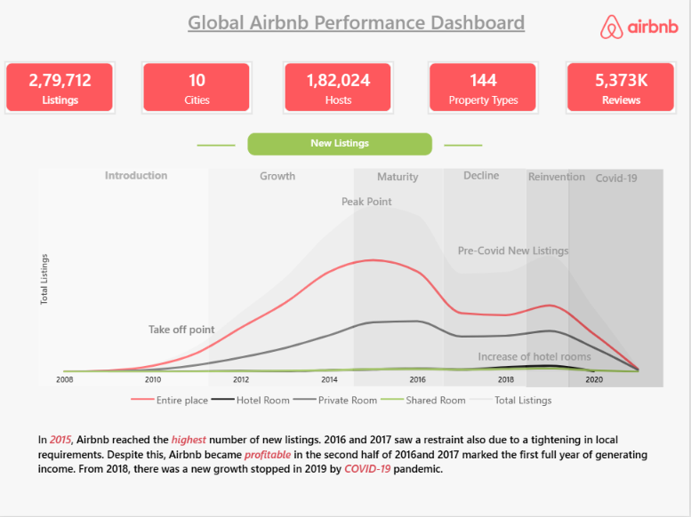
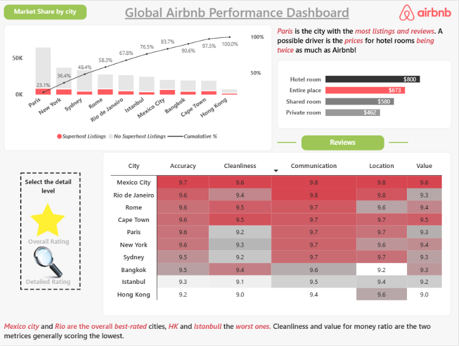
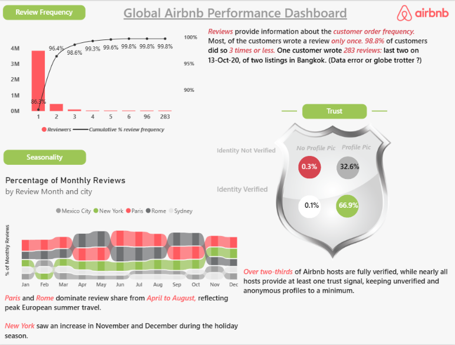

# 📊 Global Airbnb Performance & Operations Dashboard

An end-to-end Power BI business intelligence project analyzing **280,000+ listings** and **4.4M+ guest reviews** across 10 global metropolitan markets.

This project focuses on real-world commercial analytics: snowflake data modeling, complex DAX measures, customer retention diagnostics (Pareto analysis), seasonality patterns, pricing sensitivity, and host trust verification matrices.

> **Project Reference:** Developed following the analytical dashboard framework by **Mansi G.** (*End to End Power BI Project: Build an Airbnb Performance Dashboard*).  
> **Data Source:** [Maven Analytics Airbnb Listings & Reviews Dataset](https://mavenanalytics.io/data-playground/airbnb-listings-reviews).

---

## 📥 Deliverables & Quick Access

- 📄 **[Download Executive Summary (PDF)](docs/Airbnb_Performance_Report.pdf)**
- 💻 **[Download Power BI Dashboard Model (.pbix)]([https://github.com/shubhampandit5002-design/AirBnb_Global_Performance_Dashboard/releases](https://github.com/shubhampandit5002-design/AirBnb_Global_Performance_Dashboard/releases/download/v1.0.0/Airbnb_Performance_Analysis.pbix))** 
- 📂 **[Dataset Schema & Dictionary](data/data_dictionary.csv)**

---

## 🖥️ Dashboard Preview

---

## 📂 Repository Structure

        AirBnb_Global_Performance_Dashboard/
        │
        ├── assets/
        │   ├── icons/                    # UI elements and buttons
        │   │   ├── air bnb logo.png
        │   │   ├── Star.webp
        │   │   ├── Magnifying glass.png
        │   │   └── SHIELD.PNG
        │   │
        │   └── screenshots/              # High-resolution report views
        │       ├── 1_overview.png
        │       ├── 2_ratings.png
        │       └── 3_reviews.png
        │
        ├── dashboard/
        │   └── Airbnb_Performance_Analysis.pbix  # (Hosted in GitHub Releases due to >100MB limit)
        │
        ├── data/
        │   ├── Listings.csv
        │   └── data_dictionary.csv
        │
        ├── docs/
        │   └── Airbnb_Performance_Report.pdf
        │
        ├── .gitignore
        └── README.md

## 🖥️ Dashboard Architecture & Visual Walkthrough
1. Market Overview & Expansion Trends
Evaluates historical listing supply growth, room type splits (Entire Place, Private Room, Hotel Room, Shared Room), and key growth inflection points.

KPI Highlights: Centralized tracking of total listings, host community size, and coverage across 10 global cities.

Supply Trajectory: Historical annotations highlighting local regulatory shifts (2016–2017) and market recovery phases.

2. City Market Share & Ratings Breakdown
Features dynamic bookmark states allowing users to toggle between high-level city ratings and a granular multi-criteria quality matrix.

Dual-State Bookmarks: Interactive buttons toggle between city performance ranking and detailed sub-score matrices.

Quality Attribute Matrix: Conditional gradient formatting applied across Accuracy, Cleanliness, Communication, Location, and Value for Money.

3. Reviewer Behavior, Seasonality & Trust Matrix
Investigates customer retention curves, monthly demand fluctuations, and host credibility signals.

Customer Review Frequency (Pareto Curve): Diagnoses user repeat-booking cadence.

Seasonality Ribbon Chart: Cross-ranks monthly review volume to reveal geographic travel trends.

Trust Factor Quadrant: Dual-condition distribution analyzing host identity verification and profile picture coverage.

## 💡 Key Business Findings
High Churn Risk in Guest Retention:

86.5% of unique reviewers only left a review once, while 98.8% reviewed 3 times or fewer. Business growth is heavily reliant on recurring customer acquisition rather than recurring customer loyalty.

Distinct Seasonal Divergence:

Paris and Rome dominate monthly review shares from April through August (peaking above 50% combined), driven by European summer vacation demand.

New York surges sharply in November and December, capturing holiday shopping and year-end travel.

High Baseline Platform Trust:

66.9% of hosts are dual-verified (Identity Verified + Profile Picture active).

High-risk accounts (unverified with no photo) represent only 0.3% of listings, demonstrating strong platform trust standards.

## 📐 Core DAX Implementations
All calculations are organized inside a dedicated _All Measures calculation container.

1. Cumulative Reviewer Frequency Distribution
Calculates running cumulative reviewer percentages without visual distortion:

Code snippet
Cumulative Reviewers = 
VAR CurrentFreq = MAX('Reviews'[Reviews per Reviewer])
RETURN
CALCULATE(
    [Reviewers],
    FILTER(
        ALLSELECTED('Reviews'[Reviews per Reviewer]),
        'Reviews'[Reviews per Reviewer] <= CurrentFreq
    )
)
Code snippet
Cumulative % review frequency = 
DIVIDE(
    [Cumulative Reviewers],
    CALCULATE([Reviewers], ALL('Reviews'))
)
2. Monthly Review Share by City (Ribbon Chart)
Determines market-share ranking dynamically across months:

Code snippet
Percentage of Monthly Reviews = 
DIVIDE(
    [Total Reviews],
    CALCULATE([Total Reviews], ALL(Listings[city]))
)
3. Host Trust Matrix Segmentation
Evaluates dual-credential adoption across the host network:

Code snippet
Verified Profile % = 
DIVIDE(
    CALCULATE(
        [Total Hosts],
        Listings[host_identity_verified] = "t",
        Listings[host_has_profile_pic] = "t"
    ),
    [Total Hosts]
)
## 🛠️ Data Modeling & Engineering Notes
Relational Model: A 1-to-many relationship connects Listings[listing_id] to Reviews[listing_id] with bidirectional cross-filtering to allow symmetrical slicing across review metrics and listing attributes.

Chronological Date Sorting: Created calculated columns Review Month = FORMAT(Reviews[date], "mmm") and Month Number = MONTH(Reviews[date]). Applied Sort by Column on Review Month using Month Number to prevent Power BI from sorting months alphabetically.

Outlier Normalization: Built visual-level filters (Show in Review Frequency Chart = 1) to group extreme review count outliers so charts display frequencies 1–6 and edge values clearly.

## 🚀 How to Run Locally
Clone the repository:

Bash
git clone https://github.com/shubhampandit5002-design/AirBnb_Global_Performance_Dashboard.git
Download the Airbnb_Performance_Analysis.pbix file from the Releases tab.

Download the full datasets from the Maven Analytics Data Playground.

Open the .pbix file in Power BI Desktop.

5. Click the green **Commit changes** button at the top right of the
